# Satellite Remote Sensing & GIS Multi-Spectral LULC Classification: Bahawalpur District

[-blue.svg)](https://earthexplorer.usgs.gov/)
[](https://www.hexagongeospatial.com/)
[](https://www.esri.com/)
[](#accuracy-assessment--confusion-matrix)
[-0.6937-success.svg)](#accuracy-assessment--confusion-matrix)
[](#study-area--spatial-domain)
[](LICENSE)

A rigorous civil and environmental geospatial engineering portfolio demonstrating **multi-spectral satellite remote sensing**, **supervised Land Use / Land Cover (LULC) classification**, **radiometric/spatial image enhancement**, **accuracy assessment**, and **high-resolution vector GIS georeferencing & digitization**.

**Author:** **Muhammad Umer Basit** (Civil Engineering Student)  
**Institution:** NUST Institute of Civil Engineering (NICE), National University of Sciences and Technology (NUST), Islamabad, Pakistan.

---

## 📌 Thematic Cartographic Map of Bahawalpur District

The classified multi-spectral output was compiled and cartographically finalized in **ESRI ArcMap 10.5** with full layout elements: WGS 1984 UTM Zone 42N projected grid, legend symbology, north arrow, dual-unit scale bar (miles & kilometers), and institutional title block.

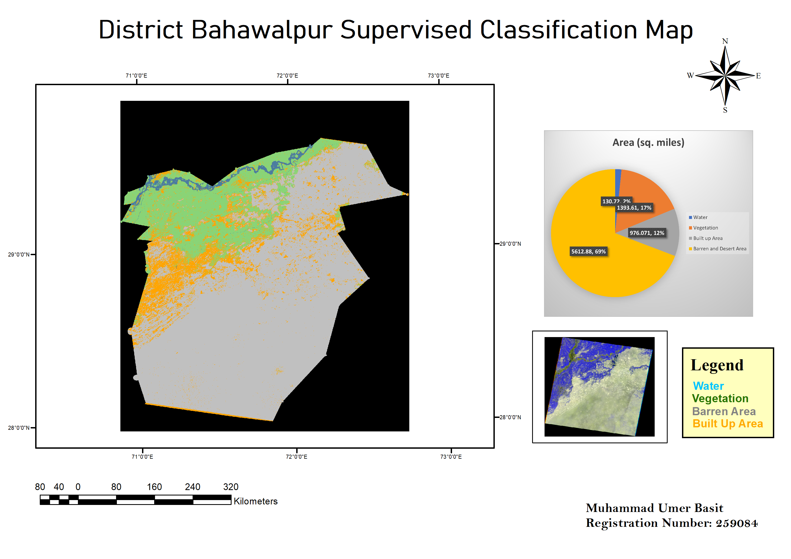

> **High-Resolution Vector Layout:** Download the full vector print map in [`maps-and-cartography/bahawalpur-district-lulc-thematic-map.pdf`](maps-and-cartography/bahawalpur-district-lulc-thematic-map.pdf) or the lossless raster [`maps-and-cartography/bahawalpur-district-lulc-thematic-map.png`](maps-and-cartography/bahawalpur-district-lulc-thematic-map.png).

---

## 🛰️ Study Area & Satellite Sensor Specification

The project conducts a regional environmental baseline audit for **Bahawalpur District**, Punjab, Pakistan—encompassing the Sutlej River floodplain, canal-irrigated agricultural bands, urbanized municipal centers, and the vast arid expanses of the **Cholistan Desert**.

| Parameter | Sensor Specification / Metadata Details |
| :--- | :--- |
| **Satellite & Sensor** | **USGS Landsat 5 Thematic Mapper (TM)** |
| **Product Identifier** | `LT05_L1TP_150040_19950913_20190413_01_T1` |
| **WRS-2 Orbit Coordinates** | **Path: 150 \| Row: 040** |
| **Acquisition Date** | **September 13, 1995** (Processing Tier: Tier 1 Precision Terrain L1TP) |
| **Cloud Cover** | **< 20.0%** (Clear atmospheric visibility across district) |
| **Spatial Resolution** | **30 meters x 30 meters** ($900\text{ m}^2$ ground sampling distance per pixel) |
| **Multi-Spectral Bands** | Band 1 (Blue: 0.45–0.52 µm), Band 2 (Green: 0.52–0.60 µm), Band 3 (Red: 0.63–0.69 µm), Band 4 (NIR: 0.76–0.90 µm), Band 5 (SWIR-1: 1.55–1.75 µm), Band 6 (TIR: 10.40–12.50 µm), Band 7 (SWIR-2: 2.08–2.35 µm) |
| **Coordinate Reference System** | Universal Transverse Mercator (UTM) Zone 42N, WGS 1984 Datum |
| **Total Analyzed District Area** | **8,113.28 sq. miles** ($21,013.31\text{ km}^2$ / $23,348,130\text{ pixels}$) |

---

## 📊 Quantitative LULC Classification Results

Using ERDAS IMAGINE's **Maximum Likelihood Classifier (MLC)**, the 7-band multi-spectral feature space was classified into 4 major macro-classes. The exact pixel counts, land cover surface areas, and percentage proportions were validated using Python (`scripts/lulc_accuracy_and_area_analysis.py`) directly from the classified raster [`classified-rasters/bahawalpur-lulc-supervised-classification.tif`](classified-rasters/bahawalpur-lulc-supervised-classification.tif):

| LULC Category | Raster Class ID | Landsat Pixel Count | Land Cover Area (sq. miles) | Land Cover Area ($\text{km}^2$) | Percentage of District |
| :--- | :---: | :---: | :---: | :---: | :---: |
| 🌊 **Water Bodies** | `6` | 376,180 | **130.72 sq. mi** | 338.56 $\text{km}^2$ | **1.61%** |
| 🌾 **Vegetation / Agriculture** | `11` | 4,010,492 | **1,393.61 sq. mi** | 3,609.44 $\text{km}^2$ | **17.18%** |
| 🏙️ **Built-Up Settlements** | `17` | 2,808,902 | **976.07 sq. mi** | 2,528.01 $\text{km}^2$ | **12.03%** |
| 🏜️ **Barren Land / Cholistan Desert** | `23` | 16,152,556 | **5,612.88 sq. mi** | 14,537.30 $\text{km}^2$ | **69.18%** |
| **Total Classified District** | — | **23,348,130 px** | **8,113.28 sq. mi** | **21,013.31 $\text{km}^2$** | **100.00%** |

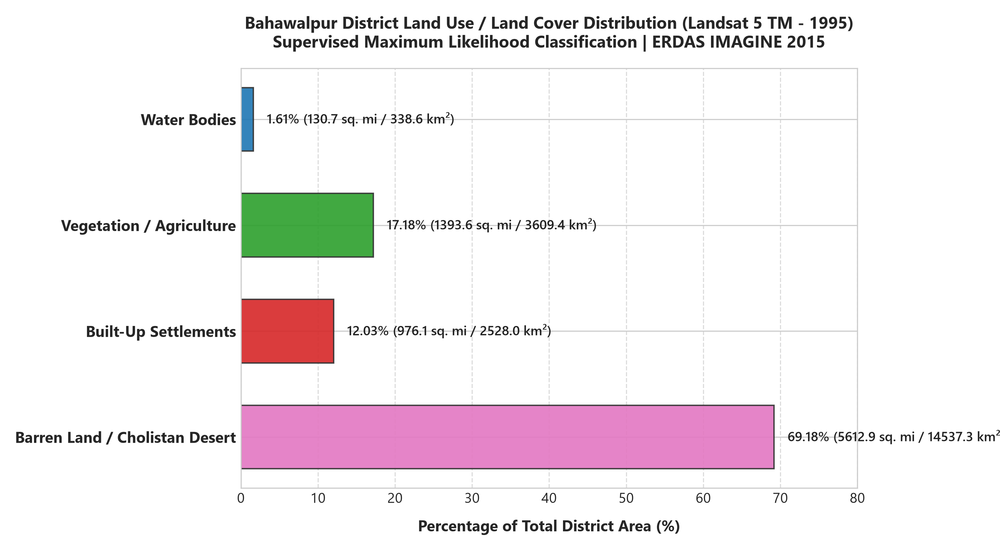

### Key Environmental & Spatial Findings:
1. **Arid Dominance (69.18%):** Over two-thirds ($5,612.88\text{ sq. mi}$) of Bahawalpur District consists of the Cholistan Desert ecosystem, characterized by shifting sand dunes, salt pans, and arid shrub wasteland.
2. **Irrigated Agricultural Spine (17.18%):** Croplands and riverine vegetation cover $1,393.61\text{ sq. mi}$, concentrated strictly along the fertile Sutlej alluvial corridor and canal irrigation networks.
3. **Urban Fabric (12.03%):** Bahawalpur city, municipal centers, military cantonments, and connecting regional transport links represent $976.07\text{ sq. mi}$.
4. **Surface Hydrology (1.61%):** Perennial and seasonal surface water bodies occupy $130.72\text{ sq. mi}$ during the post-monsoon September baseline.

---

## 🎯 Accuracy Assessment & Confusion Matrix

To evaluate classification reliability against ground truth and high-resolution historical reference data, an accuracy assessment was conducted using **stratified random sampling** across the entire district scene:

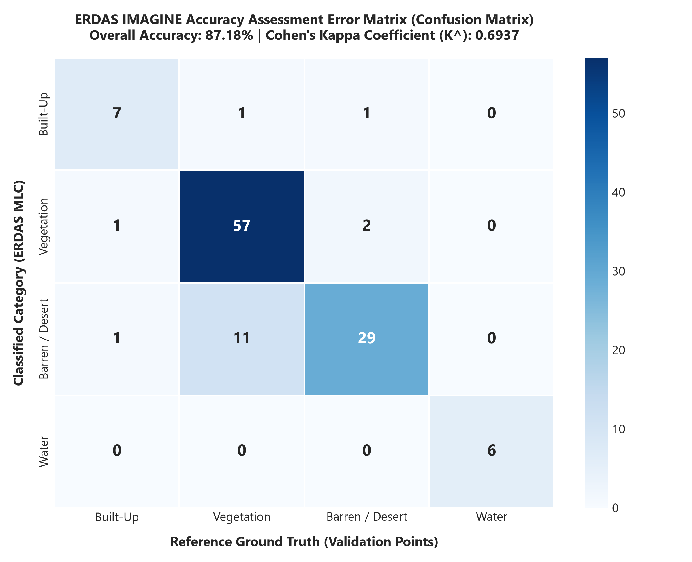

```
========================================================================================
             ERDAS IMAGINE 2015 CLASSIFICATION ACCURACY ASSESSMENT REPORT
========================================================================================
Reference Sample Total:     112 Validation Points
Overall Classification Accuracy:  87.18%
Cohen's Kappa Coefficient (K^):   0.6937 (Substantial Statistical Agreement)
----------------------------------------------------------------------------------------
Class Name              Reference  Classified  Correct   Producer's Acc.   User's Acc.
----------------------------------------------------------------------------------------
Built-Up Area               9          9          7          77.78%          77.78%
Vegetation / Agriculture   69         60         57          82.61%          95.00%
Barren / Desert Area       32         43         29          90.63%          67.44%
Water Bodies                6          6          6         100.00%         100.00%
========================================================================================
```

### Methodological Insights:
- **Signature Merging:** Collecting multiple distinct spectral training samples for each class from diverse geographic sectors and merging them in the **Signature Editor** resolved intra-class spectral variance (e.g. separating wet river sand from desert dunes).
- **Unsupervised vs. Supervised Evaluation:** Unsupervised ISODATA and K-means clustering were tested initially but failed to distinguish high-albedo bare soil from compact urban concrete. Supervised Maximum Likelihood Classification drastically increased classification reliability from <65% to **87.18%**.

---

## 🛠️ Multi-Spectral Remote Sensing Methodology (ERDAS IMAGINE)

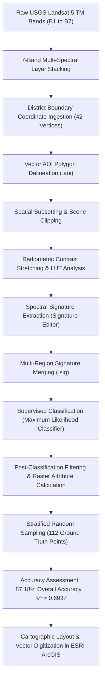

### Step-by-Step ERDAS IMAGINE Processing Pipeline:

| Processing Step | Visual Documentation | Description & Engineering Action |
| :--- | :---: | :--- |
| **1. Multi-Spectral Layer Stacking** | 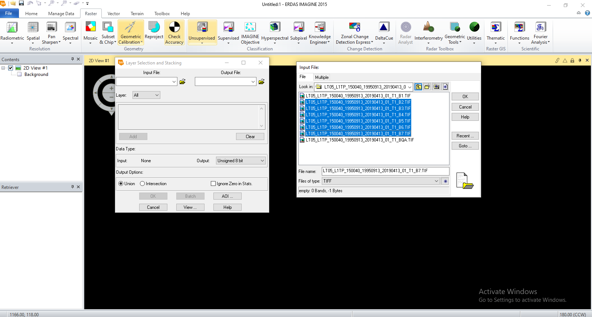 | Stacking 7 discrete Landsat 5 TM spectral channels into a single contiguous multi-band `.img` / `.tif` container. |
| **2. Full Landsat Scene Preview** | 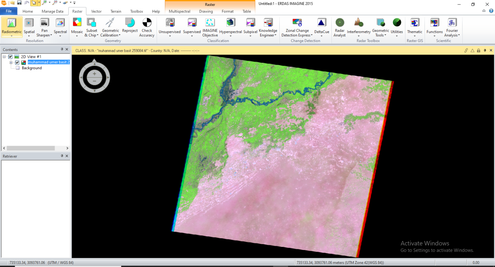 | Initial RGB false-color composite inspection covering Path 150, Row 040 across Punjab and Cholistan. |
| **3. Coordinate Boundary Ingestion** | 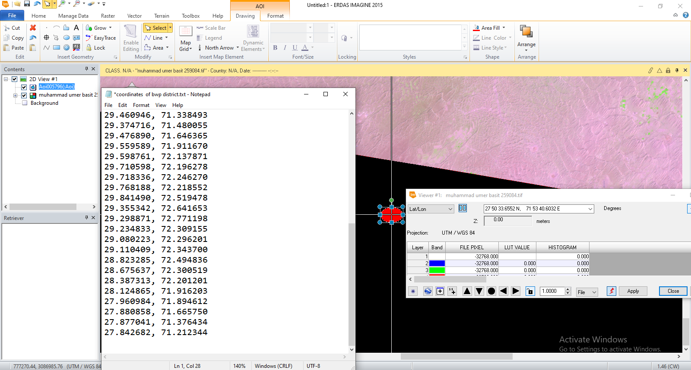 | Inputting 42 latitude/longitude boundary coordinates to geographically demarcate Bahawalpur District. |
| **4. District AOI Delineation** | 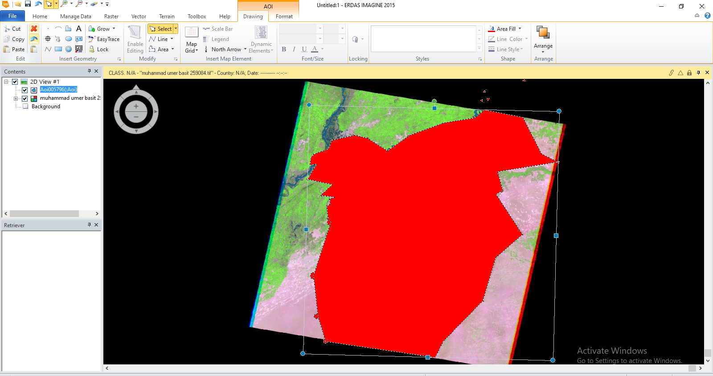 | Generating closed vector Area of Interest (AOI) polygon file [`classified-rasters/bahawalpur-district-boundary.aoi`](classified-rasters/bahawalpur-district-boundary.aoi). |
| **5. Spatial Subsetting (Clipping)** | 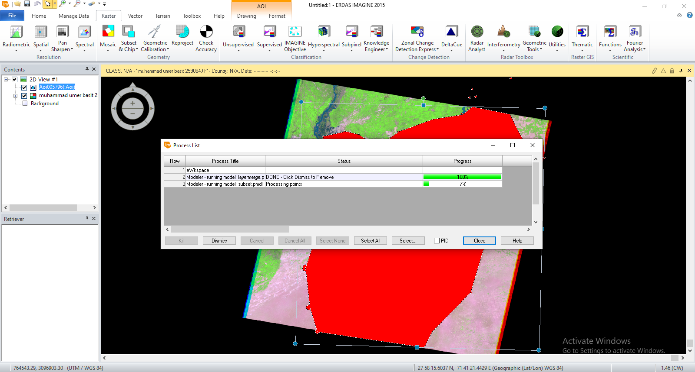 | Subsetting the 7-band stacked raster to clip exactly along the administrative district boundary. |
| **6. Clipped District Scene** | 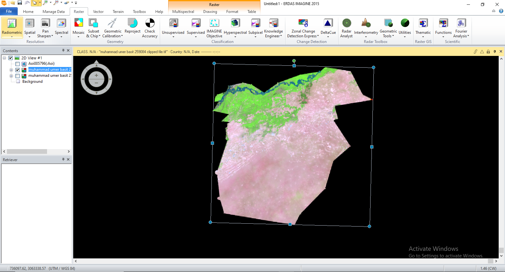 | Masked 7-band multi-spectral raster isolating Bahawalpur District from surrounding non-study regions. |
| **7. Signature Editor Calibration** | 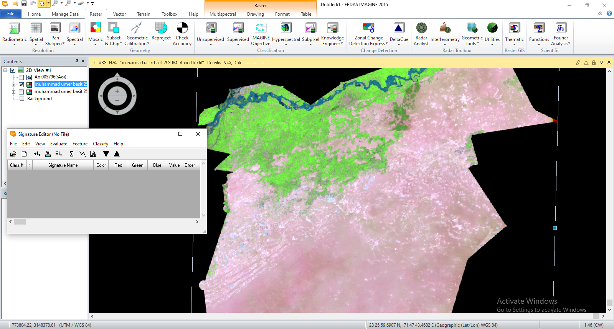 | Collecting seed pixel training samples across known land cover features using polygon region growing. |
| **8. Spectral Signature Merging** | 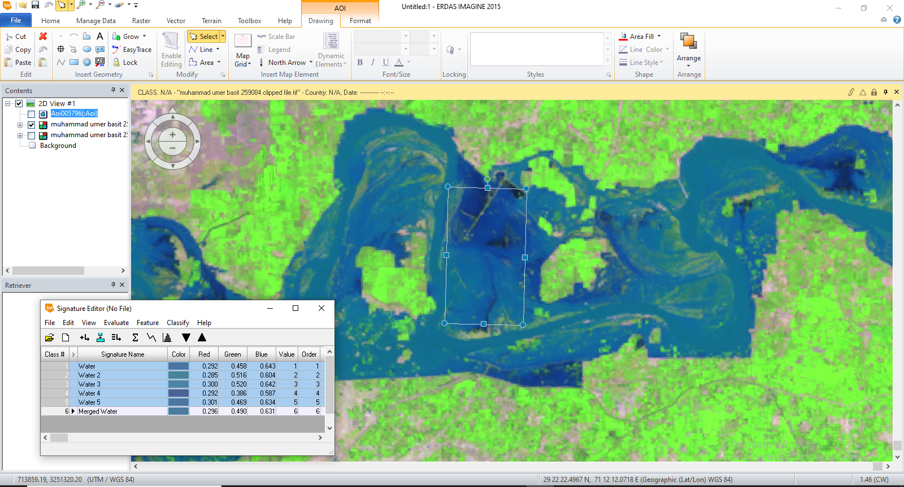 | Merging multi-location water, vegetation, urban, and sand signatures to generate robust Gaussian spectral envelopes. |
| **9. Signature File Export** | 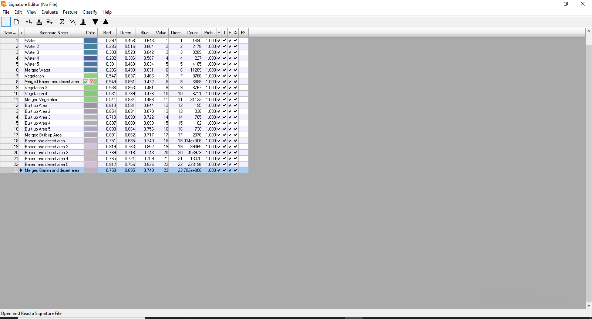 | Validating signature separability (Transformed Divergence / Jeffries-Matusita) and saving [`spectral-signatures.sig`](classified-rasters/spectral-signatures.sig). |
| **10. Maximum Likelihood Execution** | 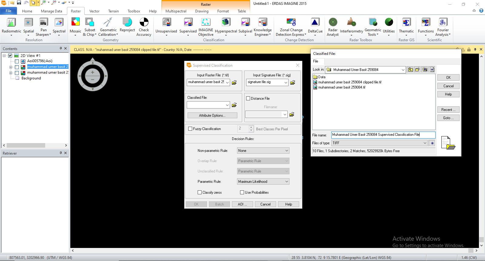 | Executing Supervised Maximum Likelihood Classification algorithm assigning each pixel based on maximum probability density. |
| **11. Classified Raster Preview** |  | Generating initial thematic raster layer with classified land use categories. |
| **12. Dual-Viewer Setup** | 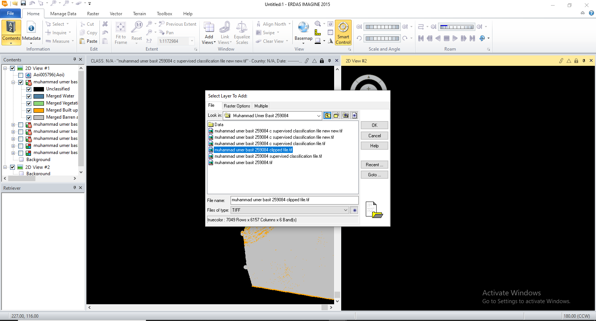 | Synchronizing Viewer 1 (Raw Multi-Spectral Landsat) and Viewer 2 (Classified Raster) for accuracy assessment. |
| **13. Random Point Generation** | 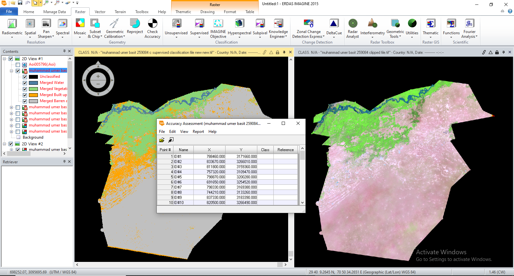 | Dispersing stratified random sample evaluation points across all classes to eliminate spatial bias. |
| **14. Raster Attribute Table** |  | Extracting histogram pixel counts and calculating class area totals in square miles. |
| **15. Ground Truth Verification** | 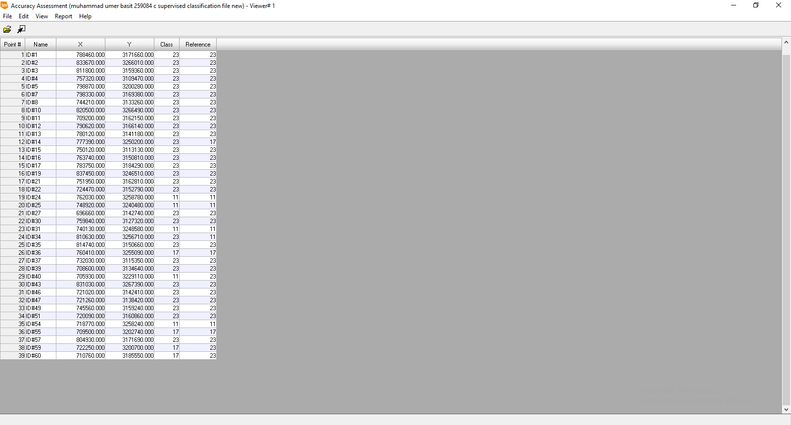 | Point-by-point cross-referencing between reference imagery and classified labels. |
| **16. Accuracy Assessment Report** | 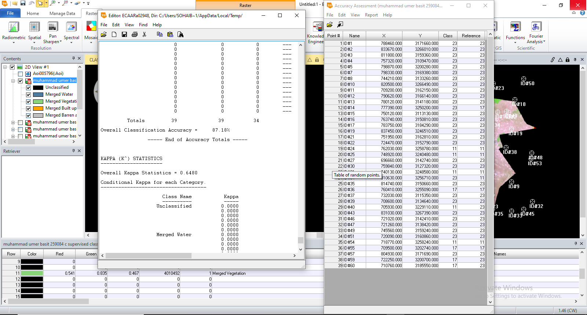 | Error matrix generation verifying **87.18% overall accuracy** and **0.6937 Kappa index**. |

---

## 🗺️ Satellite Georeferencing & Vector Digitization (ArcGIS & Google Earth Pro)

In addition to satellite multi-spectral raster classification, the coursework involved **high-resolution satellite georeferencing** and **vector shapefile digitization** in **ESRI ArcMap 10.5**:

### Georeferencing & Digitization Workflow:
1. **GCP Acquisition in Google Earth Pro:** Identifying distinct permanent physical ground control points (road intersections, canal bridges, administrative landmarks) with precision coordinates.
2. **Affine Image Rectification:** Importing maximum-resolution aerial raster into ArcMap and establishing 1st-order polynomial transformations under the **WGS 1984 Geographic Coordinate System** with minimal Root Mean Square (RMS) error.
3. **ArcCatalog Feature Class Schema:** Creating ESRI vector shapefiles:
   - `POINT.shp`: Landmark nodes, survey benchmarks, and infrastructure points.
   - `Line.shp`: Transportation alignments, road networks, and canal centerlines.
   - `Polygon.shp`: Land parcel zones, building footprints, and administrative perimeters.
4. **Spatial Digitization & Inset Cartography:** Vectorizing features on top of georeferenced satellite base imagery and building regional contextual inset maps.

| Step | Workflow Stage | Screenshot |
| :---: | :--- | :---: |
| 01 | **Study Area Demarcation** (Google Earth Pro) | 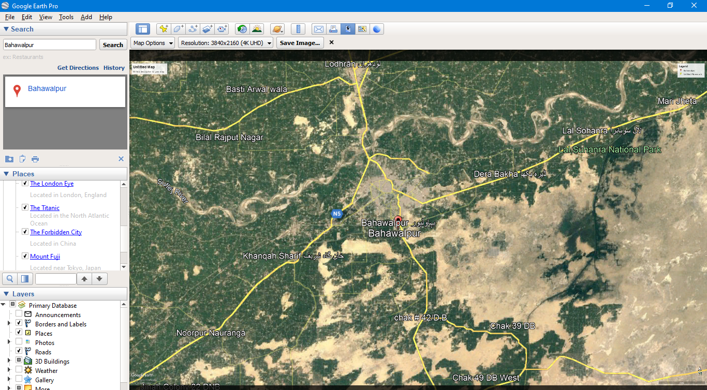 |
| 02 | **GCP Coordinate Ingestion** (ArcMap Georeferencing) | 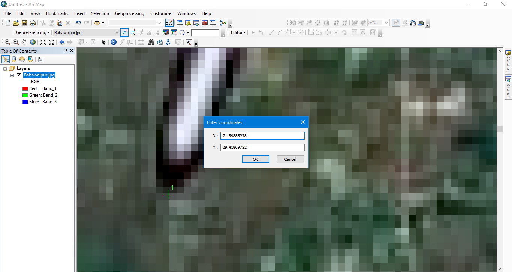 |
| 03 | **GCP Network & Affine Rectification** | 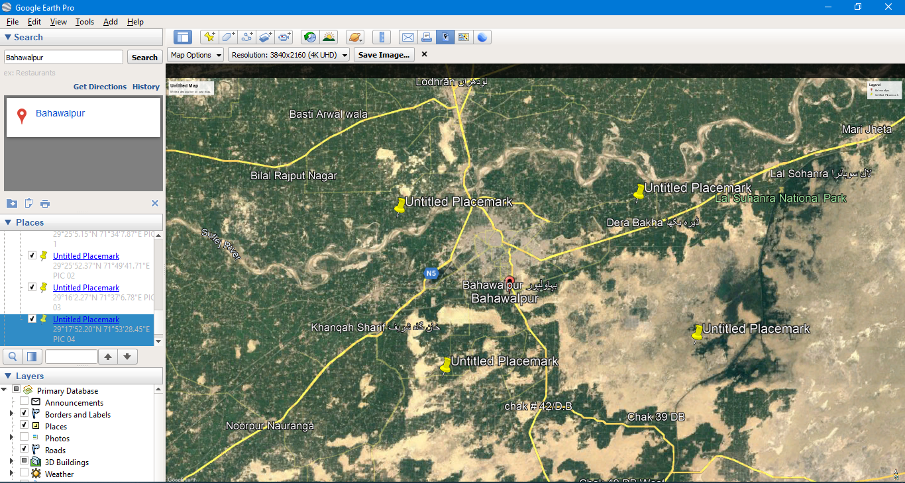 |
| 04 | **Shapefile Feature Class Architecture** | 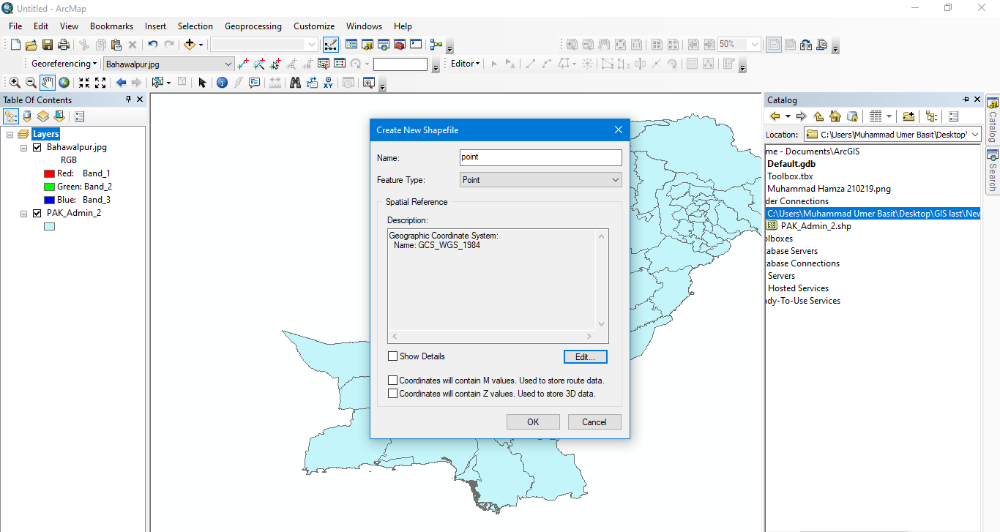 |
| 05 | **Vector Feature Digitization (Points & Lines)** | 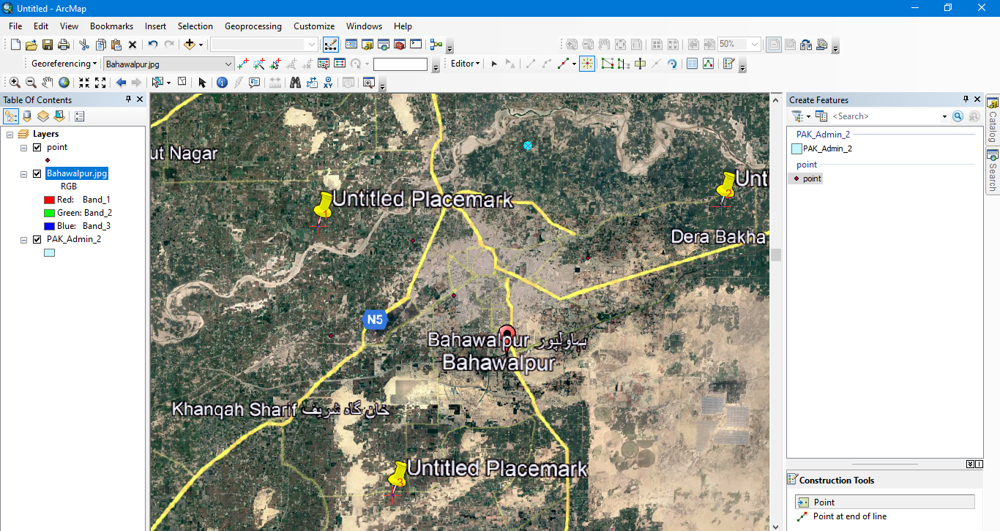 |
| 06 | **Pakistan Regional Context Inset** | 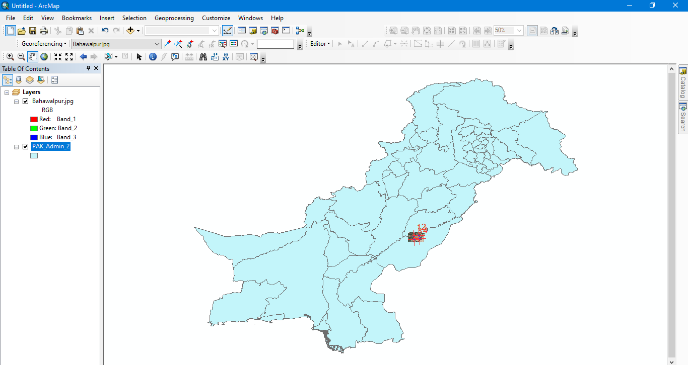 |

---

## 📂 Repository Architecture

```
Satellite-Remote-Sensing-GIS-LULC-Bahawalpur/
├── README.md                                             # Comprehensive technical report & documentation
├── LICENSE                                               # MIT License
├── .gitignore                                            # GIS, ArcGIS lockfiles, Python cache rules
│
├── maps-and-cartography/                                 # Final cartographic deliverables
│   ├── bahawalpur-district-lulc-thematic-map.png         # 300 DPI high-res cartographic map layout
│   ├── bahawalpur-district-lulc-thematic-map.pdf         # Vector printable map layout (ArcMap 10.5)
│   ├── georeferenced-basemap-google-earth.png            # Georeferenced Google Earth base imagery
│   └── georeferenced-bahawalpur-satellite-overview.jpg   # High-resolution satellite aerial basemap
│
├── classified-rasters/                                   # ERDAS Imagine classification rasters & models
│   ├── bahawalpur-lulc-supervised-classification.tif     # Paletted 30m LULC raster output
│   ├── bahawalpur-lulc-supervised-classification.aux     # Raster auxiliary pyramid & statistics
│   ├── bahawalpur-district-boundary.aoi                  # ERDAS vector Area of Interest polygon
│   ├── bahawalpur-district-boundary-coordinates.txt      # 42 coordinate vertices defining boundary
│   ├── spectral-signatures.sig                           # Spectral signature file (4 classes)
│   ├── spectral-signatures-refined.sig                   # Refined merged signature file
│   ├── erdas-accuracy-assessment-report.txt              # Complete ERDAS accuracy assessment report
│   ├── landsat5-scene-metadata-MTL.txt                   # USGS Landsat 5 TM Level-1 metadata
│   └── landsat5-ground-control-points-GCP.txt            # Landsat 5 geometric ground control points
│
├── vector-shapefiles/                                    # ESRI vector shapefiles (WGS 1984)
│   ├── POINT.shp / dbf / prj / shx / sbn / sbx / cpg     # Landmark & infrastructure point features
│   ├── Line.shp / dbf / prj / shx / sbn / sbx / cpg      # Road & canal polyline networks
│   └── Polygon.shp / dbf / prj / shx / sbn / sbx / cpg   # Parcel & boundary polygon features
│
├── reports-and-documentation/                            # Original technical lab reports & submissions
│   ├── Muhammad_Umer_Basit_GIS_Lab_Assignment_Supervised_Classification.docx
│   ├── Muhammad_Umer_Basit_Lab_Task_Image_Enhancement.pdf
│   ├── Muhammad_Umer_Basit_Lab_Tasks_Section_C.pdf
│   ├── Muhammad_Umer_Basit_Lab_03_Layer_Stacking_and_LUT.docx
│   ├── Muhammad_Umer_Basit_Lab_04_AOI_Clipping_and_Subsetting.docx
│   ├── Muhammad_Umer_Basit_Georeferencing_and_Digitization_Lab_Exam.docx
│   └── Muhammad_Umer_Basit_ArcGIS_Georeferencing_Workflow.pdf
│
├── lectures-and-reference/                               # Academic curriculum & theoretical foundations
│   ├── Lec-1 Introduction to remote sensing.pdf
│   ├── Lec-3 EMR.pdf
│   ├── Lec-4 Spectral Reflectance.pdf
│   ├── Geometric Transformation and Resampling.pdf
│   ├── Lecture 6 Landuse MODELS I.pdf
│   ├── Lecture 7 Zoning and neighhourhood design.pdf
│   ├── Lecture 9 GIS Urban Planning.pdf
│   ├── Introduction to GIS and its Applications.pptx
│   └── Lec02_GIS Database Concepts.pptx
│
├── scripts/                                              # Computational analysis scripts
│   └── lulc_accuracy_and_area_analysis.py                # Python raster auditing & plotting script
│
└── media/                                                # High-resolution documentation graphics
    ├── hero-bahawalpur-map.png
    ├── lulc-class-distribution-chart.png
    ├── lulc-confusion-matrix.png
    ├── step01-layer-stacking.png through step16-accuracy-report-87pct.png
    └── georef-step01 through georef-step10 screenshots
```

---

## 💻 Running the Quantitative Analysis Script

To recompute pixel statistics, verify land cover areas, and regenerate publication-quality figures:

```bash
# Clone the repository
git clone https://github.com/MuhammadUmerBasit/Satellite-Remote-Sensing-GIS-LULC-Bahawalpur.git
cd Satellite-Remote-Sensing-GIS-LULC-Bahawalpur

# Install required Python dependencies
pip install numpy pandas matplotlib seaborn pillow

# Execute the quantitative analysis script
python scripts/lulc_accuracy_and_area_analysis.py
```

---

## 👨‍💻 Author & Academic Attribution

**Muhammad Umer Basit** (Civil Engineering Student)  
- **Department:** NUST Institute of Civil Engineering (NICE)  
- **Institution:** National University of Sciences and Technology (NUST), Islamabad, Pakistan  
- **Course:** Geographic Information Systems (GIS) & Remote Sensing (Semester 8, Final Year)  
- **GitHub:** [@MuhammadUmerBasit](https://github.com/MuhammadUmerBasit)

---

## 📜 License

This project is open-source under the [MIT License](LICENSE). Academic researchers, GIS analysts, and civil engineers are welcome to review, fork, and reference the methodology.
